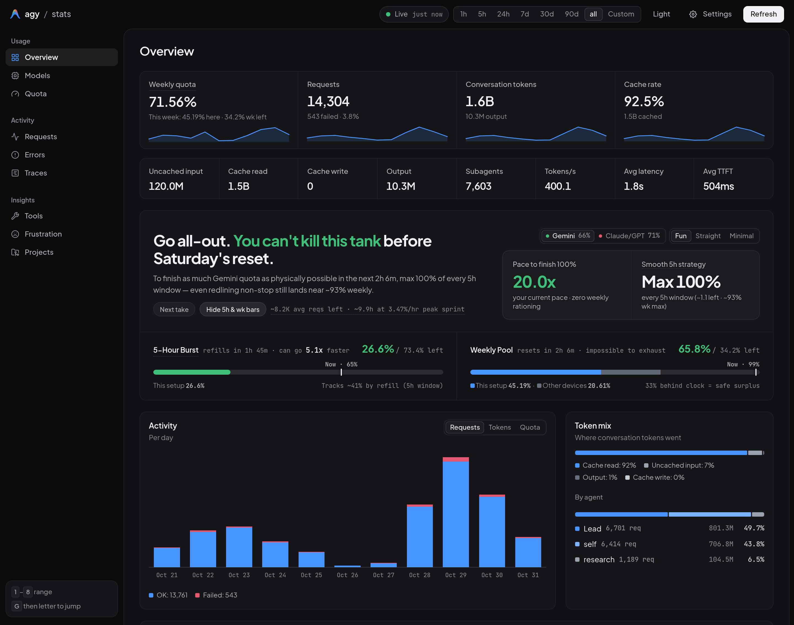

# agy-stats

Zero-dependency, single-file telemetry, live quota pacing, and session trace analytics for **Google Antigravity** — supporting both **Antigravity CLI (`agy`)** and **Antigravity Desktop / IDE**.

Ships as a standalone Python 3 stdlib executable (`agy-stats`) with an interactive Web Dashboard (`http://localhost:3872`) and rich terminal CLI reports (`agy stats --cli`). Zero `pip` packages, zero Node/npm dependencies, zero `sudo`, and zero global `PATH` bloat.



---

## Platform & Surface Support

`agy-stats` automatically discovers and aggregates session logs and metadata across all local Antigravity surfaces (`~/.gemini/antigravity-cli`, `~/.gemini/antigravity`, and `~/.gemini/antigravity-ide`).

| Platform | Shells Configured | Surfaces Supported | Status |
| :--- | :--- | :--- | :--- |
| **Linux** | Fish, Bash, Zsh | Antigravity CLI (`agy`) + Desktop / IDE | **Tested** |
| **macOS** | Zsh, Bash, Fish | Antigravity CLI (`agy`) + Desktop / IDE | **(Untested)** |
| **WSL2** | Bash, Zsh, Fish | Antigravity CLI (`agy`) + Desktop / IDE | **(Untested)** |
| **Windows** | PowerShell 5.1 & PowerShell 7 | Antigravity CLI (`agy.exe`) + Desktop / IDE | **(Untested)** |

> **Note:** Only native Linux is verified in production. macOS, WSL2, and Windows PowerShell support are included with full cross-platform path/shell handling, but are explicitly marked **(Untested)**.

---

## Installation (Zero Global Bloat)

### Linux (Tested) · macOS `(Untested)` · WSL2 `(Untested)`

```sh
curl -fsSL https://github.com/segfawlt/agy-stats/releases/latest/download/install.sh | sh
```

### Windows PowerShell `(Untested)`

```powershell
irm https://github.com/segfawlt/agy-stats/releases/latest/download/install.ps1 | iex
```

### Install from a Local Git Checkout

```sh
git clone https://github.com/segfawlt/agy-stats.git
cd agy-stats
./install.sh
```

*(On Windows PowerShell `(Untested)`: `.\install.ps1`)*

### Exact User-Space Footprint

`agy-stats` never touches system directories, never asks for `sudo`/Administrator privileges, and never mutates your global `PATH`:

- **Executable:** `~/.local/bin/agy-stats` *(plus `~/.local/bin/agy-stats.cmd` on Windows)*
- **Antigravity `/stats` Plugin:** `~/.gemini/config/plugins/stats/` *(removed automatically by `agy stats --uninstall`)*
- **Preferences:** `~/.config/agy-stats/config.json`
- **Scoped `agy stats` subcommand hook:**
  - **Fish:** `~/.config/fish/functions/agy.fish`
  - **Bash / Zsh:** fenced `# >>> agy-stats >>> ... # <<< agy-stats <<<` function in `~/.bashrc` / `~/.zshrc`
  - **PowerShell `(Untested)`:** fenced `# >>> agy-stats >>> ... # <<< agy-stats <<<` function in `$PROFILE`

Works whether you use `agy` CLI, Antigravity Desktop / IDE standalone, or both.

---

## Usage

### Inside Antigravity Chat (`/stats` Companion Plugin)

Installing `agy-stats` automatically registers the `/stats` skill plugin in `~/.gemini/config/plugins/stats/`:

```text
/stats                # Interactive time-window selector (or your pinned default range)
/stats 5h             # 5-hour window overview (live quota, KPIs, hourly bar chart, models, sessions)
/stats today          # Today's overview & hourly activity chart since midnight
/stats 7d             # 7-day overview & daily bar chart
/stats days           # 10-day daily token & weekly quota bar chart
/stats all            # All-time telemetry overview & daily chart
/stats web            # Launch detached Web Dashboard at http://localhost:3872
/stats onboard        # Configure bare /stats behavior & displayed report sections
```

### Terminal CLI & Web Dashboard (`agy stats`)

```sh
agy stats                    # Launch your configured default mode (Web Dashboard or CLI)
agy stats --web              # Start Web Dashboard at http://localhost:3872
agy stats --web --no-open    # Start Web Dashboard server without opening a browser tab
agy stats --cli              # Print full terminal telemetry overview
agy stats --summary          # Compact 1-line telemetry & quota status banner
agy stats --quota            # Live 5-hour & weekly server quota pools + pacing runway
agy stats --tokens           # Token spend, cache hit rate, model mix & daily ledger
agy stats --models           # Per-model token, latency, error & quota breakdown
agy stats --sessions         # Top sessions ranked by weekly quota share
agy stats --tools            # Tool call & shell command leaderboard
agy stats --frustration      # Detected frustration & error-loop signals
agy stats --today            # Filter CLI ledger to today
agy stats --days 30          # Filter CLI ledger to the last 30 days
agy stats --all              # Show full historical daily ledger
agy stats --json             # Emit raw structured JSON telemetry
```

### Onboarding, Preferences & Maintenance

```sh
agy stats --onboard          # Re-run the 4-step interactive setup wizard
agy stats --settings         # Open interactive terminal settings menu
agy stats --check-update     # Check if a newer signed release is available
agy stats --update           # Verify (Ed25519 + SHA-256 + bytecode) & atomically self-update
agy stats --uninstall        # Cleanly remove binary and all shell hooks (zero trace)
agy stats --uninstall --purge # Also delete ~/.config/agy-stats/config.json
```

---

## Security & Anti-Hijack Architecture

1. **Pinned Ed25519 Release Signatures (`RFC 8032`):**
   Every official release is signed offline with an Ed25519 private key (`agy-stats.sig`) and paired with a SHA-256 checksum (`agy-stats.sha256`). Both `install.sh`, `install.ps1`, and `agy stats --update` verify the Ed25519 signature against the pinned `RELEASE_PUBKEY_HEX` (`45fdf468d952accdcac5b6e3624f550cb065d463c82585bd889408816c686ec1`) using pure-Python stdlib math **before** executing or swapping the binary.
2. **GitHub Username / Repository Rename Protection:**
   - If the maintainer renames their GitHub username or transfers the repository, `agy-stats` follows GitHub's repository redirect, verifies the Ed25519 signature against the pinned public key, and **automatically migrates** `update_url` in `config.json` to the new canonical GitHub Releases URL (ignoring temporary `objects.githubusercontent.com` blob redirects).
   - If a third party ever squats the old GitHub username, they do not possess the Ed25519 private key — both `install.sh` and `agy stats --update` cryptographically reject the payload and leave your binary untouched.
3. **Hardened Local Web Server (`127.0.0.1`):**
   Binds strictly to `127.0.0.1` using `ThreadingHTTPServer`, enforces a loopback `Host` allowlist (DNS-rebinding defense), validates `Origin` and `Sec-Fetch-Site` on API routes, and requires `Content-Type: application/json` + `X-Agy-Stats: 1` anti-CSRF headers with bounded request bodies on all `POST` endpoints.

---

## Maintainer Release Guide

Keep your 32-byte Ed25519 private seed strictly outside Git at `~/.config/agy-stats/keys/release_ed25519.key` (`chmod 600`).

```sh
# 1. Run pre-flight gates & sign agy-stats.sha256 + agy-stats.sig locally
./release.sh --local

# 2. Dry-run preview of next release (patch | minor | major | vX.Y.Z)
./release.sh minor

# 3. Bump version, sign, commit, tag, push & publish GitHub Release via gh CLI
./release.sh minor --publish
```
